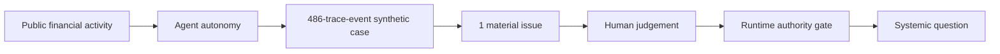

# Ghost V3 — repository guide

> Current documentation refreshed 13 November 2026 against accepted implementation `bf34d11`. This is internal repository documentation; audience-facing materials remain unbranded. Earlier records below are historical, not the current specification.

The accepted demonstration is complete. The executive producer confirmed that the final HTML has been submitted. This housekeeping update changes documentation only; it does not rebuild or alter that delivery.

The presenter-led demonstration opens with **WHEN AI STARTS ACTING, WHO IS THE SUPERVISOR?** and ends with **WHERE DOES SUPERVISION RESIDE?** Eight beats contain **51 principal presenter states**. All scenarios are synthetic and illustrative; public research supplies context rather than evidence of these exact events occurring in production.

## Delivery and development

- [Submitted standalone HTML](dist/demo.html): self-contained browser delivery, including styles and modules, usable offline without a server, API key or external AI calls.
- [Existing PowerPoint integration notes](POWERPOINT_INTEGRATION.md): browser launch guidance and integration boundaries. No delivery or PowerPoint work is part of this documentation refresh.
- Developer source entry: `index.html`; Node.js 20 or newer is required for repository scripts, not to open the standalone HTML.
- `npm run dev` serves the source at `http://127.0.0.1:4173`; `npm test` runs the deterministic checks; `npm run build` regenerates the standalone delivery. Do not rebuild the submitted file as routine housekeeping.

The submitted `dist/demo.html` is 240,364 bytes. SHA-256: `450f5e90a7985ff6edc4fe244ae974eed9299a43f193cd7c195c02a6e79da9aa`.

## Accepted narrative

| Beat | States | Focus |
| --- | ---: | --- |
| 1 · From answers to actions | 6 | Rules, patterns, investigation and agents |
| 2 · Failed-trade investigation | 6 | Eight workstreams, 27 subtasks, 486 trace events; one material signal and human cognitive limits |
| 3 · Supervisory influence | 1 | Who decided what the human saw? |
| 4 · Investigator recommendation | 1 | Risk 76 and a separate illustrative 74% prediction |
| 5 · Central-bank near miss | 14 | Human-triggered source challenge, conditional 76→39, independent policy restriction, incomplete domain coverage and historical review |
| 6 · NAV | 7 | Publication approval changes supervisory priority while an inadequately validated proxy compounds |
| 7 · Systemic effects | 9 | Six bounded agents respond to market conditions their collective actions help change |
| 8 · Finale | 7 | Supervision arrangements, capability versus authority, four dimensions, five practical questions, final question |

The original recommendation remains recommend-only. A separate deterministic policy finding does not validate the original reasoning or confer execution authority. The original runtime gate still returns **ESCALATE** without executing the restriction; its evidence is retained without a standalone runtime slide.

## Controls and evidence

The existing presenter bar supports Back, Next, Pause/Play, Replay, fullscreen and deliberate reset. Explicit source and policy checks require their action buttons; ordinary Next or Space cannot bypass them. Evidence drawers disclose contextual evidence after the intended reveal. The final question holds indefinitely with Next disabled; Back and Replay remain available.

The opening carries one disclosure: “Public-source research. All demonstration scenarios are synthetic and illustrative.” Detailed attribution and qualifications remain in evidence drawers, exports and [PUBLIC_SOURCES.md](PUBLIC_SOURCES.md). Internal run identities are preserved; audience exports use the existing neutral projection.

## Documentation map

- [Build and preservation contract](00_README.md)
- [Current storyboard](01_storyboard.md)
- [Actors and mandates](02_agent_specs.md)
- [Scenario arithmetic and causality](03_scenarios.md)
- [Data and provenance](04_data_model.md)
- [Runtime and review boundaries](05_runtime_governance.md)
- [Visual and interaction contract](06_ui_wireframes.md)
- [Verification record](07_eval_harness.md)
- [Historical reports, artifacts and legacy files](HISTORY.md)

The paper remains supporting research, not an alternative current UI specification: [consolidated spine](papers/ghost-in-the-harness/GHOST_IN_THE_HARNESS_CONSOLIDATED_SPINE_2026-10-06.md) and [research ledger](papers/ghost-in-the-harness/GHOST_IN_THE_HARNESS_RESEARCH_LEDGER_2026-10-06.md).

## Limitations and maintenance

No live model inference, client data or real transaction execution is involved. The 74% prediction is illustrative, not calibrated analytics. Daily NAV movement checks are fictional internal controls, not regulatory error tolerances. Policy examples are fictional institutional rules, not invented real legal obligations. Public sources retain their individual maturity and jurisdictional qualifications.

Preserve accepted narrative, financial calculations, evidence identities and submitted delivery. No open-source licence has been selected; this refresh does not change licensing. Historical reports record what was verified at their original review dates and do not supersede this guide.


---

<details>
<summary>Historical design and implementation record — superseded; retained verbatim</summary>

# REGULATOR//GHOST

**Where does intelligence end and authority begin?**

REGULATOR//GHOST is a presenter-led decision theatre for financial-services audiences. It places one reproducible, **synthetic teaching simulation** inside three real-world arcs: capital-markets operations, agentic transactions, and correlated investment decisions. The public examples are documented in [PUBLIC_SOURCES.md](PUBLIC_SOURCES.md); they are context, **not claims that this demo is deployed**.

## The idea in 30 seconds

One synthetic failed trade opens an investigation. Eight agents create 27 sub-tasks and 486 trace events in 3.2 simulated seconds. A material entity reclassification is logged but buried. Asking a person to approve the whole trace produces **ON WHAT BASIS?** A separate simulated Supervisory AI links the one event that matters to a proposed restriction. The human can then judge the disputed fact and consequence. Even with a risk coefficient of 76 and illustrative 74% prediction, the runtime gate says **ESCALATE**: intelligence has not created authority.



## The three arcs

| Arc | Public grounding | Question on stage |
| --- | --- | --- |
| Capital-markets operations | Broadridge reports production exception workflows; Standard Chartered describes an illustrative failed-trade agent workflow. | If one exception generates hundreds of machine actions, what can a human meaningfully review? |
| Payments and digital assets | Sygnum reports a controlled live-mainnet pilot with client signing; payment networks report pilots and rollouts; BIS/MAS research programmable compliance. | What can an agent prepare, initiate or execute, and under whose mandate? |
| Asset management | IOSCO and the FSB discuss AI use and vulnerabilities; BIS Project Logos studies correlated portfolio agents in simulation. | Could individually compliant agents create a collective outcome no one intended? |

Source maturity and important qualifications are in [PUBLIC_SOURCES.md](PUBLIC_SOURCES.md). The synthetic failed-trade case is **not** a claim that any named firm, regulator or market has experienced this sequence.

## Main show

Eight escalating audience beats, 26 presenter advances: answers → actions; agents help but humans lose the thread; AI supervises AI but allocates human attention; prediction is not permission; one disputed fact changes the case; restraint followed by human judgement; individually correct agents create systemic effects; the ghost. The causal case is **one stage with three reveals** after the no-breach moment: a coherent explanation (classification → 39→76 → recommendation), a separate source and Bank Compliance challenge, then an animated 76→39 counterfactual. The challenge and conditional counterfactual do not settle the truth. The single **ESCALATE** verdict stops autonomous execution first; human judgement then faces the validation dilemma. Full runtime checks are available in Show More.

The on-stage authority ladder is **ASSIST → INVESTIGATE → ASSESS → ACT**; supervision is a later meta-control, not another rung. A restrained corner indicator tracks the AI role and either its human benefit or its governance question. Main-stage detail controls say **SHOW MORE**; the drawers retain precise evidence and source language.

Beat 7 then asks what happens when individual controls work. Six hypothetical portfolio agents, each within mandate but optimising for a different constraint, respond independently to a shared market signal. Their first actions may change the market conditions they observe; feedback can prompt a stronger second wave. The changed market may then transmit pressure in parallel through funding/leverage, collateral and settlement/cash channels, rather than through one inevitable serial chain. This persistent-stage sequence is **OPTIMISE → FEEDBACK → TRANSMIT → SYSTEM CHANGED → WHO SUPERVISES THE SYSTEM?** It is a **regulatory-research / synthetic illustration**, not a reported incident or a second executable scenario. That qualification is kept here, in source notes and evidence detail, rather than on the audience-facing stage. Ghost ends on **WHERE DOES INTELLIGENCE END AND AUTHORITY BEGIN?**

The important event, `EntityGraph/T-17` (`EVT-0238`), is truly in the 486-trace-event stream. It changes a *derived* classification from central-bank-related to commercial-counterparty. A linked score update moves **39 → 76**; an institutional challenge supports a **76 → 39** counterfactual. The original source is never overwritten. The Supervisory AI finding cites the exact classification, score, recommendation and mandate-boundary events. Evidence, trust controls and the complete run remain available in contextual drawers and export.

The human-in-the-right-loop distinction is concrete: a person should not be asked to approve 486 undifferentiated machine actions. They should own the consequential judgement, while recognising that contested evidence may still need manual verification or AI-assisted validation. Human authority is not automatic certainty. The Supervisory AI is itself an **attention allocator**: its provenance, uncertainty, contestability, independence, disagreement, causal trace, reproducibility and limited authority are inspectable.

## Run locally

Requires Node.js 20 or newer. No installation, API key, live LLM, market feed or network connection is needed.

```sh
npm run dev
```

Open [http://127.0.0.1:4173](http://127.0.0.1:4173). If that port is occupied, use `PORT=4174 npm run dev`. Stop the server with Ctrl-C. Run `npm test` for deterministic scenario and presentation-state checks.

| Control | Action |
| --- | --- |
| Right arrow / Space | Next reveal |
| Left arrow | Previous reveal |
| R | Reset the current beat, or replay its active animation |
| E | Open contextual evidence where available |
| P | Pause or resume an animation |
| F | Toggle fullscreen |
| Esc | Close the detail drawer |
| Home | Reset the show |

The discreet on-screen arrows work too. **AUTHORISE / REJECT** in the naive-review moment are interactive teaching controls: neither records approval; both lead to **ON WHAT BASIS?** Evidence controls appear only where relevant. The drawer exports the full synthetic run.

## Architecture and boundaries

- [src/scenario.mjs](src/scenario.mjs): deterministic synthetic run, evidence links, causal reconstruction, counterfactual and authority gate.
- [src/presentation.mjs](src/presentation.mjs): eight beats with presenter-controlled micro-reveals and non-executing naive-review logic.
- [src/theatre.mjs](src/theatre.mjs): projection stage, actual event replay, keyboard controls and evidence drawer.
- [styles.css](styles.css): dark, low-chrome 16:9 theatre; the main stage does not scroll at desktop projection size.
- [tests/](tests/): trace, gate and presentation-state assertions. [scripts/dev-server.mjs](scripts/dev-server.mjs) uses Node alone.

The runtime gate distinguishes a deterministic prohibited transaction from a probabilistic proposed restriction. In the main run, **no rule has been breached**, evidence is disputed and the simulated agent has recommendation—not execution—authority. **ESCALATE** means the restriction is not executed. The gate is a teaching model, not a legal decision engine or implementation of a public framework.

## Evidence maturity and limitations

The source notes and evidence detail distinguish **LIVE PRODUCTION**, **LIVE PILOT**, **OFFICIAL PROTOTYPE**, **REGULATORY RESEARCH** and **SYNTHETIC TEACHING SIMULATION**; these labels are deliberately absent from the main stage. Commercial labels describe the linked public examples, not this software. The six-agent optimise/feedback/transmit sequence is a synthetic mechanism-of-concern, **not an observed production incident**. Metric gaming remains an optional future **SYNTHETIC RED-TEAM TEST**, not part of the main show.

Trace records use `EVT-XXXX` sequence IDs and stable demo-local `AGT-…` identities. The identity format is inspired by registered-agent governance ideas; it is **not** a MAS SAFR naming convention. A trace event is telemetry/audit instrumentation, not necessarily a model deliberation or external API call. SHOW MORE exposes the actor, mandate, task, parent event and evidence source.

All entities, transactions, scores, percentages, timings and case events in the core run are invented. The 74% prediction is illustrative, not calibrated analytics or a regulatory threshold. The Supervisory AI is deterministic simulated logic, not a live independent AI model. Event fingerprints are stable demo identifiers, not cryptographic proof. This repository contains no real transaction or client data, employer-confidential material or internal policy text. It is **not a production supervisory platform, legal or regulatory advice, or an endorsement by Broadridge, Standard Chartered, Sygnum, BIS, MAS, FSB, IOSCO, IMDA or any employer**.


## Ghost in the Harness: paper, evidence and agent constitution

The paper is the source argument; this demo is a selected synthetic adaptation of it, like an anime based on a manga. The demo's themes must remain traceable to paper propositions, with their evidence limits intact. The wider paper also covers institutionalising expertise, functional cognition, evaluator integrity, governed learning and constitutional design.

- [Consolidated spine and revised report outline](papers/ghost-in-the-harness/GHOST_IN_THE_HARNESS_CONSOLIDATED_SPINE_2026-10-06.md): original paper history, current demo mapping, practical outputs and a proposed constitutional foundation for the digital agent family.
- [Research ledger and evidence-to-action matrix](papers/ghost-in-the-harness/GHOST_IN_THE_HARNESS_RESEARCH_LEDGER_2026-10-06.md): regulatory interests, source qualifications and bounded Maju, AlphaLab and ZiLiOS pilot proposals.

The constitutional articles and product work are proposals. They do not add live AI, execution authority or self-modification to this teaching demo. Product adoption requires explicit versions, domain mandates, enforcing controls and journey/recovery evidence.

## Licence and contributions

No open-source licence has been selected. Public availability does not imply unrestricted reuse; see [GitHub's licensing guidance](https://docs.github.com/en/repositories/managing-your-repositorys-settings-and-features/customizing-your-repository/licensing-a-repository). Licence selection remains an explicit project decision. Suggestions are welcome through issues; do not submit confidential information.

For the underlying design intent, see the [build contract](00_README.md), [storyboard](01_storyboard.md) and [evaluation plan](07_eval_harness.md).

</details>
